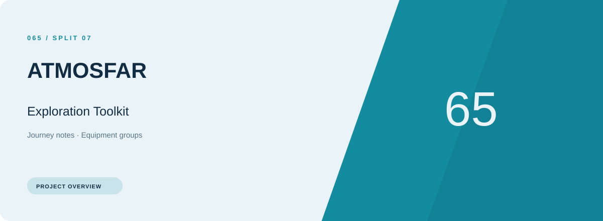
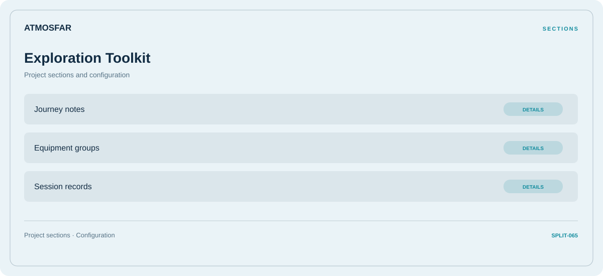

# 🎮 ATMOSFAR Exploration Toolkit

**Journey notes · Equipment groups · Session records**

## ⚡ Features

ATMOSFAR Exploration Toolkit brings journey notes and equipment groups into one section-based interface. Session records provides the third part of the workflow.

### ⚙️ Journey notes

Route stages, transport context, and the notes associated with each part of the journey.

### 🧩 Equipment groups

Equipment categories and the associated selection or configuration options.

### ⌨️ Session records

Session and activity information grouped by the task or context it belongs to.

## 🖥️ Project navigation

## 📥 Download

The button and cover open the project's download page. Use the information supplied with the downloaded package for installation and release-specific requirements.

## 📚 Project documentation

- [Feature reference](docs/FEATURES.md)
- [Download information](docs/DOWNLOAD.md)
- [Project page](index.html)

---

ATMOSFAR Exploration Toolkit · Program documentation and download information.
